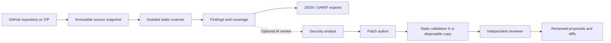

<div align="center">

# CodeAgentTool

### Scan your code. Review the findings. Inspect the proposed fixes.

Security scanning for GitHub repositories and ZIP archives, with optional AI patch review.
Built for one workstation or a small team sharing one host.

[](https://github.com/SuryaSriramD/CodeAgentTool/actions/workflows/ci.yml)
[](LICENSE)

[Quick start](#quick-start) · [Capabilities](#what-you-can-do) · [How it works](#how-it-works) · [Documentation](#documentation)

</div>

---

CodeAgentTool scans an immutable copy of your source, reports security findings with coverage evidence, and can turn selected findings into reviewed patch proposals. Static analysis runs without an AI account. For AI review, explicitly select an OpenAI model or a local Ollama model.

> Source files stay unchanged. Patch validation runs in a disposable copy. Submitted repositories are never built or executed.

## Quick start

Install Docker with Compose support, then run:

```sh
git clone https://github.com/SuryaSriramD/CodeAgentTool.git
cd CodeAgentTool
docker compose up --build -d
```

Open [the workspace](http://localhost:3000), choose a ZIP archive or an HTTPS GitHub repository URL, and leave **Static analysis** selected for your first scan. The job page shows progress and tool coverage; the report includes findings and exports. Explore the API at [localhost:8000/docs](http://localhost:8000/docs).

The first build needs internet access to download the pinned scanning tools and vulnerability advisory database. The default deployment binds to localhost and requires no password or API credentials. Jobs and reports persist in named Docker volumes.

<details>
<summary>Using a macOS external drive?</summary>

If Docker rejects AppleDouble file attributes with a `failed to xattr` error, run:

```sh
python3 scripts/compose.py up --build -d
```

The wrapper stages clean build contexts and uses the same deployment and data volumes.

</details>

For provider configuration, private repositories, team access, and local development, see the [full setup guide](QUICK_START.md).

## What you can do

| Capability | What you get |
| --- | --- |
| Scan GitHub or ZIP sources | An immutable snapshot with a recorded source identity and file hashes. |
| Inspect security findings | Pinned static engines, source evidence, and explicit coverage, failures, and skipped files. |
| Request AI review | Separate analyst, patch author, and reviewer roles, using your selected hosted or local model. |
| Inspect proposed fixes | Accepted, rejected, and unresolved proposals with validation evidence and downloadable diffs. |
| Track findings over time | Named ZIP projects and GitHub branch streams, human decisions, append-only notes, and conservative comparisons. |
| Use reports in CI | Saved JSON/SARIF exports and an API-client CLI with policy exit codes. |
| Resume interrupted work | Persisted jobs, events, and agent checkpoints; separate cancellation, retry, and rerun actions. |

Scans and reviews are separate runs. You can review a retained report without repeating static analysis. A worker restart preserves completed work; interrupted model calls require an explicit retry.

## How it works



The scanner runs in an isolated service without external network access. Jobs, reports, and review checkpoints persist in SQLite and local volumes.

During AI review, the author proposes precise edits against the snapshot. Trusted scanners validate the edits, and a separate reviewer assesses the evidence. The author gets at most one revision and revalidation. A failed deterministic check blocks validated status.

> A proposal that passes static validation remains unapplied and runtime-untested. Review the diff and run your own tests before applying it.

### Choose your review provider

| Mode | Setup | Model requests |
| --- | --- | --- |
| Static analysis | Start Compose and submit a source. | None; no AI account required. |
| Local AI review | Run Ollama, make a model available, then select it in Setup. | Sent to the configured Ollama service. |
| Hosted AI review | Set `OPENAI_API_KEY` server-side and select an exact model ID in Setup. | Selected source context and findings are sent to OpenAI; API billing applies. |

The selected provider is the only destination for that review; there is no automatic cloud fallback. See [provider setup and review limits](QUICK_START.md#enable-multi-agent-review).

## Coverage

| Area | Supported checks |
| --- | --- |
| Source languages | Python, JavaScript, TypeScript, Java, Kotlin, Scala, Go, C, C++, Ruby, PHP, Swift, Rust, Bash, C#, Visual Basic .NET, and F#. |
| Configuration and markup | YAML, JSON, XML, HTML, and Dockerfiles. |
| Static engines | Semgrep baseline rules, Bandit for Python, and four security checks per .NET language through Roslyn/FSharp.Compiler.Service. |
| Dependencies | Trivy audits supported dependency inventories against an offline advisory database. |

Language support means the documented checks have positive and safe-negative regression fixtures. It does not imply comprehensive vulnerability detection. Partial scans and unsupported manifests are visible in reports and must not be treated as clean scans.

The default `security-v1` profile remains available. The opt-in `security-v2` candidate adds 38 language/family combinations across all 17 languages, with 228 additional positive/negative fixtures. See [rule coverage and dependency-resolution limits](codeagent-scanner/rules/README.md).

## Use it in CI

With the API running and the [CLI dependencies installed](QUICK_START.md#development-and-checks), submit a local source directory and save SARIF:

```sh
python codeagent-scanner/cli.py --server http://localhost:8000 scan /path/to/source \
  --project-name "My application" --profile security-v1 --severity high \
  --format sarif --output /path/to/artifacts/codeagent.sarif
```

| Exit code | Meaning |
| --- | --- |
| `0` | Policy passed. |
| `1` | Qualifying findings detected. |
| `2` | Operational, incomplete, or incomparable result. |
| `130` | Canceled. |

The [GitHub Actions example](.github/workflows/codeagent-example.yml) starts an ephemeral Compose stack, scans the checkout statically, uploads SARIF, and enforces the policy result. It runs through `workflow_dispatch`. See [CLI authentication, baselines, and CI setup](QUICK_START.md#cli-and-continuous-integration).

## Documentation

| Guide | Read it for |
| --- | --- |
| [Quick start](QUICK_START.md) | Setup, providers, retention, team access, development, and operating commands. |
| [Runtime architecture](docs/runtime-architecture.md) | Service boundaries, state transitions, agent workflow, and extension points. |
| [Rulepack](codeagent-scanner/rules/README.md) | Language checks, profiles, regression fixtures, and coverage limits. |
| [Evaluation](codeagent-scanner/evaluation/README.md) | The human-gated corpus and recorded static/single-agent/multi-agent benchmark. |
| [Candidate verification](docs/improvements-vnext.md) | Current results, quality gates, and release limits. |
| [Baseline verification](docs/verification.md) | Original implementation checks and external integration limits. |

<details>
<summary>Project map</summary>

| Directory | Purpose |
| --- | --- |
| `codeagent-scanner/api` | HTTP API and isolated scanner RPC. |
| `codeagent-scanner/pipeline` | Durable jobs, reports, retention, and orchestration. |
| `codeagent-scanner/integration` | Typed analyst/author/reviewer workflow and providers. |
| `codeagent-scanner/analyzers`, `rules`, `dotnet-analyzer` | Static engine adapters and owned rules. |
| `codeagent-scanner-ui` | Next.js UI, same-origin API proxy, and generated API types. |
| `codeagent-scanner/tests`, `fixtures` | Current runtime and engine regression tests. |
| `codeagent-scanner/evaluation` | Human-gated 204-case corpus and resumable benchmark; separate synthetic metric tests. |
| `research/legacy-tests`, `codeagent-scanner/camel`, `codeagent-scanner/codeagent` | Retired tests and historical agent experiments, outside the product runtime. |

Older setup documents and root agent scripts describe historical prototypes. Use this README and the quick start for the supported runtime.

</details>

## Verification

[Product checks](https://github.com/SuryaSriramD/CodeAgentTool/actions/workflows/ci.yml) run API/workflow tests, strict UI type checking and build, generated-contract drift checks, browser interaction tests, real pinned-engine fixtures without network access, and an ephemeral Compose CLI scan with SARIF export. Real engine tests fail if a required tool or advisory database is missing.

With Compose running, `npm run test:live` in `codeagent-scanner-ui` exercises a real browser ZIP upload, scanner job, report, and export without using a model. See the [development and checks guide](QUICK_START.md#development-and-checks) for local commands.

Infrastructure tests alone cannot promote the candidate. [Independent corpus review](codeagent-scanner/evaluation/corpus-v1/REVIEW.md) and the [recorded benchmark](codeagent-scanner/evaluation/README.md) must establish the agreed fix-quality and false-positive improvements without reduced recall. All 204 proposed corpus labels currently await human review.

## License

[MIT](LICENSE) · Copyright (c) 2026 Surya Sriram Duvvuri
